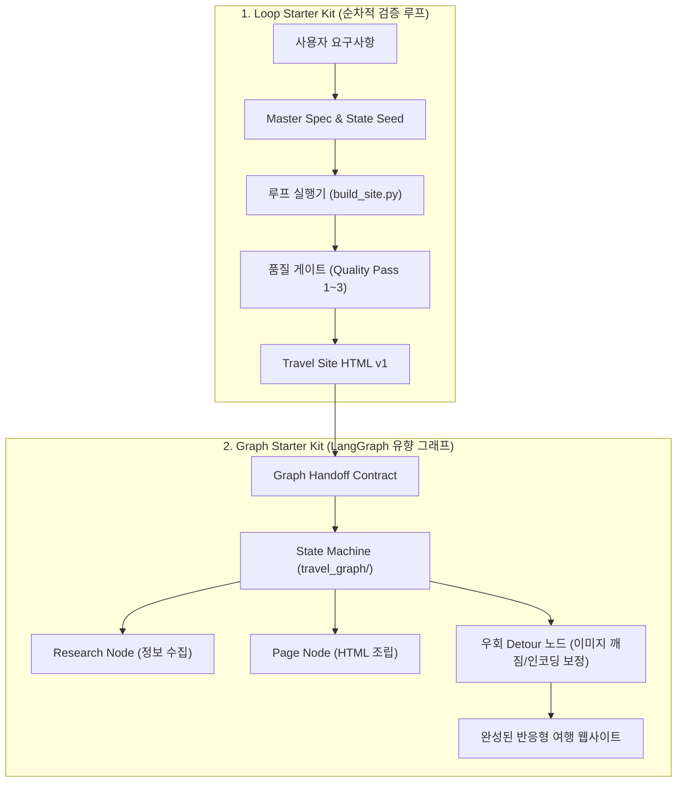

# 🏭 AI Factory: LangGraph 기반 상태 머신 & 루프 자율 에이전트 시스템

본 저장소는 LangGraph를 기반으로 한 **상태 머신 그래프 에이전트(Graph Starter Kit)**와 단계별 루프 계약을 통해 자율적으로 웹사이트를 구축하는 **루프 스타터 키트(Loop Starter Kit)**를 다룬 고급 멀티 에이전트 개발 실습 프로젝트입니다.

---

## 📌 1. 전체 아키텍처 및 시스템 흐름



---

## 📖 2. 핵심 서브 프로젝트 분석

### 🌐 1. `graph_starter_kit` (LangGraph 기반 에이전트)
- **개념**: 복잡한 비즈니스 로직을 노드(Node)와 조건부 엣지(Conditional Edge), 체크포인트(Checkpoint), 예외 우회 경로(Detour)로 설계한 자율 에이전트 그래프
- **핵심 모듈 (`travel_graph/`)**:
  - `nodes.py`: 리서치, 페이지 생성, 품질 검수 노드
  - `edges.py`: 품질 통과 여부 및 오류 상태에 따른 분기 조건
  - `detours/`: 깨진 이미지 자동 복원(`image_dead.py`), 텍스트 인코딩 보정(`encoding.py`), 이미지 규격 검증(`image_spec.py`)
  - `contract.py`: 노드 간 상태 전이 스키마(State Schema) 검증
- **검증 스크립트 (`scripts/`)**:
  - `check_graph_shape.py`: 그래프 토폴로지 유효성 검사
  - `check_graph_readiness.py`: 실행 전 종속성 및 사전 조건 확인
  - `check_page_contract.py`: 생성된 HTML의 규격 및 CSS/JS 요구사항 검증
  - `check_quality_passes.py`: 3단계 품질 통과 검증

### 🔄 2. `loop_starter_kit` (루프 실행기)
- **개념**: 단일 루프 사이클을 통해 입력을 받아 사전에 정의된 `MASTER_SPEC.md`와 `LOOP_CONTRACT.md`를 완벽히 준수하도록 코드를 반복 개선
- **핵심 요소**:
  - `LOOP_CONTRACT.md`: 입력 스키마, 상태 파일 갱신 규칙, 정지 조건
  - `specs/`: 화면 디자인(`02_PAGE_DESIGN.md`), 정보 수량(`03_INFORMATION_COUNT.md`), 안전성(`04_BOUNDARY_TASKS_SAFETY.md`) 등 단계별 스펙 정의
  - `src/build_site.py`: 스펙 기반 사이트 빌더

---

## 🗂️ 3. 저장소 디렉토리 구조 (권장 배포 구조)

> **주의 (제외 항목)**: Python 가상환경(`.venv/`), `.langgraph_api/`, 실제 API Key가 담긴 `.env`(대신 `.env.example` 유지), `NVIDIA Corporation/umdlogs`, 중복 zip 파일은 제외합니다.
> `D:\Study\AI_factory`는 본 폴더의 중복 압축 풀림 버전이므로 제외합니다.

```text
study_langgraph_ai_factory/
├── README.md                           # 통합 안내 가이드 (본 문서)
├── graph_starter_kit/                  # LangGraph 상태 머신 에이전트
│   ├── travel_graph/                   # 핵심 그래프 소스 (nodes, edges, detours)
│   ├── specs/                          # 그래프 설계 명세서 (00_INDEX ~ 06_DETOUR)
│   ├── scripts/                        # 그래프 검증 스크립트군
│   ├── templates/                      # 실패 보고서, 품질 패스 템플릿
│   ├── pyproject.toml                  # 프로젝트 의존성 설정
│   └── README.md
└── loop_starter_kit/                   # 루프 기반 빌더 에이전트
    ├── specs/                          # 루프 마스터 명세서
    ├── scripts/                        # 루프 상태 검증기
    ├── src/build_site.py               # 사이트 빌더 스크립트
    └── README.md
```

---

## 💡 4. LangGraph 에이전트의 핵심 기법

1. **상태 불변성 및 스키마 검증**: 모든 노드는 이전 노드의 State를 바탕으로 새로운 상태 증분을 반환하며, 런타임에 `contract.py`로 유효성 보장.
2. **동적 우회 회복 (Detour Recovery)**: 에이전트가 생성한 결과물에 누락이나 오류가 발생했을 때 즉시 실패하지 않고, 전용 Detour 노드로 분기하여 자가 치유(Self-healing) 후 메인 플로우로 복귀.
